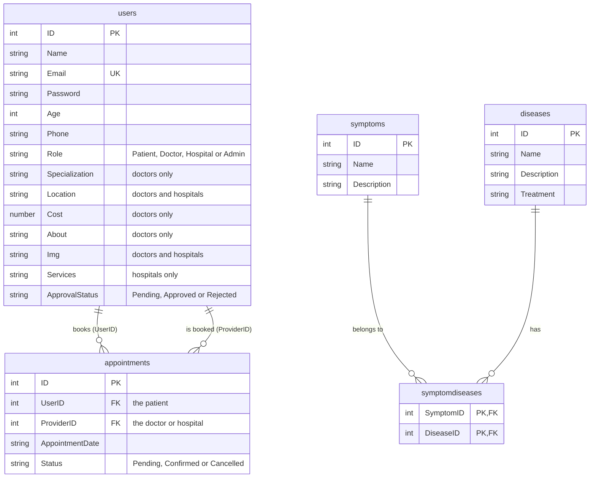

# MedMind: Database Diagrams

Five tables. The schema is in [backend/database/app.sql](backend/database/app.sql).

## How the tables work together

- **One table for all people.** A doctor is a row in `users` with `Role = 'Doctor'` and the listing columns filled in. A hospital is the same with `Role = 'Hospital'`. A patient leaves the listing columns empty.
- **An appointment** joins two users: the patient (`UserID`) and the doctor or hospital (`ProviderID`). Whether the provider is a doctor or a hospital is the provider's `Role`.
- **Symptoms and diseases** are many-to-many. One row in `symptomdiseases` means "this disease has this symptom". The symptom checker counts these rows.
- **Deleting is automatic downstream.** Deleting a user deletes their appointments. Deleting a symptom or a disease deletes its rows in `symptomdiseases`.

## Rules the database keeps

| Rule | Where |
|---|---|
| Email is unique | `users.Email UNIQUE` |
| Role is one of 4 words | `CHECK` on `users.Role` |
| Approval status is one of 3 words | `CHECK` on `users.ApprovalStatus` ("Rejected" also means blocked) |
| Appointment status is one of 3 words | `CHECK` on `appointments.Status` |
| No orphan appointments or links | `FOREIGN KEY ... ON DELETE CASCADE` |
